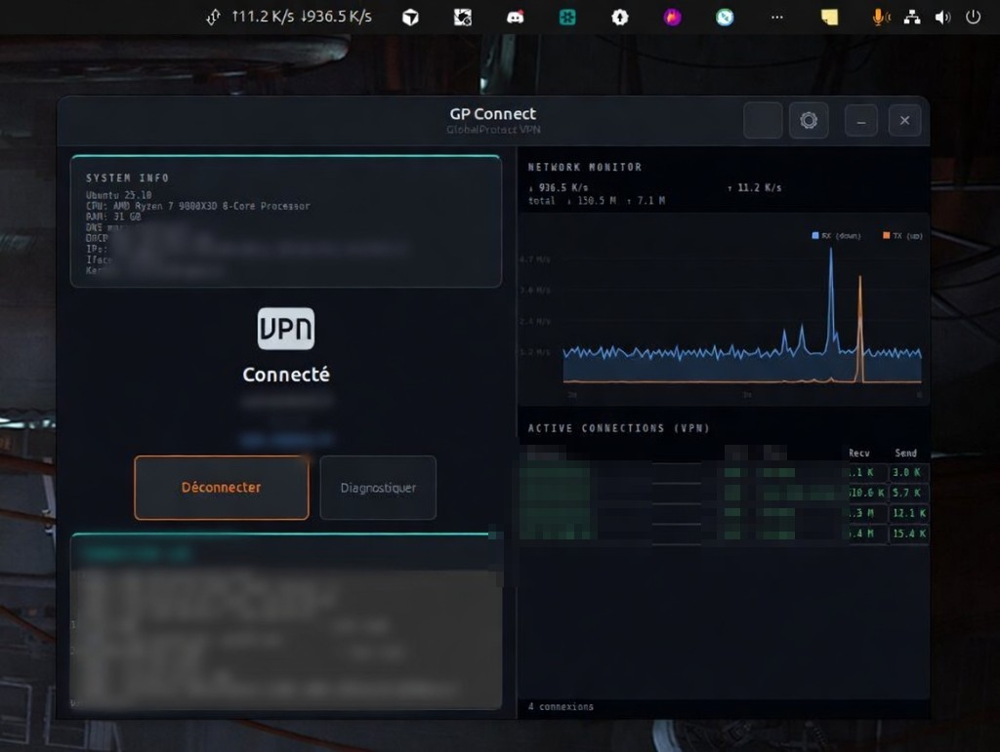

# GP Connect

A modern GTK3 VPN client for **Palo Alto GlobalProtect** on Linux, built with OpenConnect and SAML/SSO authentication.



## Features

- **SAML/SSO authentication** via integrated WebView or external browser (Chrome/Firefox)
- **Auto-detect connection mode** — automatically switches between internal (no-tunnel, user-ID + HIP) and external (full tunnel) based on network location
- **Real-time bandwidth monitoring** — side panel with live throughput graph (Cairo) and active VPN connections table
- **DNS auto-fix** — detects and repairs broken DNS configuration caused by vpnc-script bugs on Ubuntu 24.04+
- **DHCP DNS discovery** — reads DNS servers from resolvectl, NetworkManager, or DHCP lease files
- **HIP report spoofing** — built-in fake HIP report generator (firewall, antivirus, MDM, encryption)
- **Auto-reconnect** — automatically re-authenticates when the tunnel drops unexpectedly (up to 3 retries)
- **Session persistence** — stores session tokens securely for faster reconnection
- **Dark UI** — modern dark theme inspired by enterprise dashboards, with teal accent borders and monospace typography
- **System tray** — AppIndicator with live bandwidth display, minimizes to tray on close

## Requirements

- **Ubuntu 24.04+** (tested on 24.04, 24.10, 25.04, 25.10)
- `sudo` (to install system packages and the `.deb`)
- Internet access on first build (downloads [gp-saml-gui](https://github.com/dlenski/gp-saml-gui) as SAML fallback)

All other dependencies (Python/GTK, OpenConnect, WebKit2, `git`, …) are installed by `./install.sh`.

## Installation

```bash
./install.sh
```

This installs system dependencies, builds `dist/gp-connect_<version>_<arch>.deb`, and installs it with `apt`.

Other modes:

```bash
./install.sh --deps      # system packages only
./install.sh --build     # dependencies + .deb (do not install)
./install.sh --install   # install an already-built package from dist/
./install.sh --local     # copy into ~/.local without a .deb
```

Uninstall a `.deb` install with `gp-connect-uninstall` or `sudo apt remove --purge gp-connect`.
A `--local` install is removed with `./uninstall.sh`.

## Quick Start

1. Launch **GP Connect VPN** from the application menu or run `gp-connect`
2. Click the **gear icon** to open Settings
3. Enter your VPN server address (e.g. `vpn.company.com`)
4. Click **Se connecter** — a browser window will open for SSO authentication
5. Complete the authentication — GP Connect will establish the tunnel automatically

## Configuration

### Connection Modes

| Mode | Description |
|------|-------------|
| **Auto** (default) | Detects network: internal IP reachable = no-tunnel mode, otherwise = full tunnel |
| **Portal** | Cloud gateways via portal (getconfig.esp → gateway selection) |
| **Gateway** | Direct connection to on-prem gateway (prelogin-cookie → tunnel) |
| **Internal** | No-tunnel mode: authentication + HIP keepalive only (user-ID on firewall) |

### DNS Configuration

GP Connect automatically handles DNS routing through the VPN tunnel. On systems where `vpnc-script` fails to configure DNS (known Ubuntu 24.04+ bug), it:

1. Detects the missing DNS servers on the tunnel interface
2. Uses learned DNS from previous successful connections
3. Falls back to manually configured DNS servers (Settings > DNS VPN)
4. Tests resolution and logs diagnostic details

You can manually specify DNS servers in **Settings > DNS VPN (fallback)** if auto-detection fails.

### HIP Reports

GlobalProtect gateways may require Host Information Profile (HIP) reports. GP Connect includes a built-in fake HIP generator that reports:

- Operating system and hostname
- Firewall status
- Antivirus software
- Disk encryption
- MDM enrollment
- Backup software

Configure these values in **Settings > HIP**.

## Architecture

```
gp_connect.py     # Main application (~5800 lines)
hipreport.py      # HIP report script for OpenConnect --csd-wrapper
data/              # Application icon (SVG)
build_deb.sh      # Debian package builder
install.sh         # Local installer
```

### Authentication Flow

```
User clicks Connect
       |
   Auto-detect mode
       |
   +---------+---------+
   |                   |
Internal            External
(no tunnel)         (tunnel)
   |                   |
Browser auth       WebView/Browser
   |                SAML auth
   |                   |
gateway_login       openconnect
(user-ID + HIP)    (ESP tunnel)
   |                   |
HIP keepalive      DNS forcing
loop               + monitoring
```

## Limitations

- **Linux only** — GTK3 application, no Windows/macOS support
- **WebKit2GTK crashes** — on some Ubuntu 25.10 systems with Wayland, the integrated WebView may crash (SIGABRT). The app automatically falls back to external browser authentication
- **HIP reports are spoofed** — the built-in HIP generator sends fake data. Some gateways may reject connections if real endpoint compliance is enforced
- **No split-tunnel control** — routing is managed by OpenConnect and the gateway configuration; GP Connect doesn't override split-tunnel rules
- **SAML token is single-use** — the prelogin-cookie cannot be reused for DNS server discovery; DNS servers must be learned from a previous connection or configured manually
- **vpnc-script DNS bug** — Ubuntu 24.04+ has a known bug where vpnc-script doesn't properly configure DNS via resolvectl. GP Connect works around this, but the first connection from a new network may require manual DNS configuration
- **Session timeout** — GlobalProtect sessions typically expire after 24 hours; the server may disconnect earlier due to idle timeout (30 min) or missing HIP reports
- **No IPv6 tunnel** — only IPv4 VPN addresses are supported

## Troubleshooting

### DNS not working after connection

Check the **CONNECTION LOG** panel for DNS diagnostic messages. If you see:

```
[DNS] ⚠ Aucun serveur DNS sur tun0 (bug vpnc-script Ubuntu 24.04+)
```

Go to **Settings** and fill in **DNS VPN (fallback)** with your corporate DNS servers (ask your IT team).

### WebView crashes on authentication

If the SAML WebView crashes, GP Connect will fall back to external browser authentication. You can also force external browser mode by connecting in **Internal** mode.

### Disconnects after 30 minutes

This is usually caused by missing HIP reports. Ensure HIP is enabled in Settings with mode "fake". The gateway may also enforce an idle timeout — GP Connect will attempt auto-reconnection up to 3 times.

## License

MIT

## Credits

- [OpenConnect](https://www.infradead.org/openconnect/) — Multi-protocol VPN client
- [gp-saml-gui](https://github.com/dlenski/gp-saml-gui) — GlobalProtect SAML authentication helper
# gp-connect
